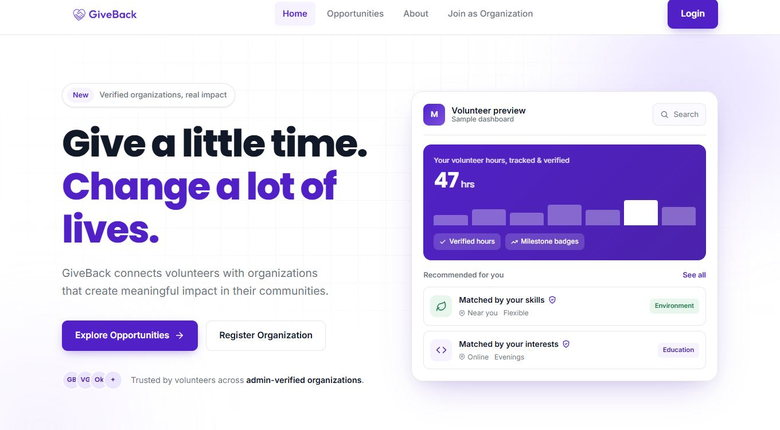

# GiveBack source

**React client · Independent full-stack university project**

This repository contains the actual browser application for GiveBack. Volunteers can browse opportunities, apply, and log hours. Organizations have separate management workflows. The client includes route guards, role-specific pages, form validation, and a shared API layer.

[Public web interface ↗](https://giveback-frontend.vercel.app/) · [Engineering showcase and data model ↗](https://github.com/INDZO/GiveBack-Showcase)

## Local development

Use Node.js 22 or later. In `frontend`, run `npm ci`, then `npm run dev`. `npm run build` produces the static client bundle.

The client defaults to `http://localhost:5066`. Copy `frontend/.env.example` to `frontend/.env` if you have a compatible development API and want to configure `VITE_API_BASE_URL`. Features that read or write data require that API. Use a development service and synthetic accounts.

This public release contains the React frontend. The [architecture showcase](https://github.com/INDZO/GiveBack-Showcase) documents the private ASP.NET Core, Clean Architecture, CQRS, EF Core and SQL Server backend. The sample account shortcuts were removed from this release.
