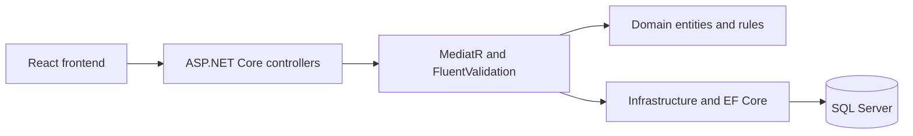

# GiveBack API

The API handles HTTP, JWT validation, and authorization. MediatR dispatches commands and queries through FluentValidation. The application layer works with the domain model and infrastructure interfaces. EF Core persists data in SQL Server.

## Local development

Use .NET 10, the EF Core 10 CLI, and a fresh local SQL Server database. From this directory, set `ConnectionStrings__DefaultConnection` to your local connection string and `Jwt__Key` to a fresh random signing key of at least 32 bytes. Keep both values in your shell or local secret store. Issuer and audience defaults are in `src/GiveBack.Api/appsettings.json`.

1. Run `dotnet restore` and `dotnet build`.
2. Run `dotnet ef database update --project src/GiveBack.Infrastructure --startup-project src/GiveBack.Api` against the fresh database.
3. Run `dotnet run --project src/GiveBack.Api -- --urls http://127.0.0.1:5066`. Open `/healthz` for the health check and `/swagger` for OpenAPI.
4. Start the React frontend using its local API URL, `http://localhost:5066/api/v1`.

The migrations create the schema. Account creation happens through the normal registration flow. The local release contains no default administrator accounts or automatic demo seeding.
