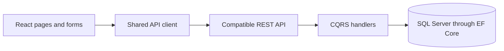

# GiveBack browser architecture

This repository contains the React pages and API client. The backend in the diagram is documented in the [engineering showcase](https://github.com/INDZO/GiveBack-Showcase/blob/main/docs/architecture.md). Client route guards shape navigation; authorization belongs to the API.

